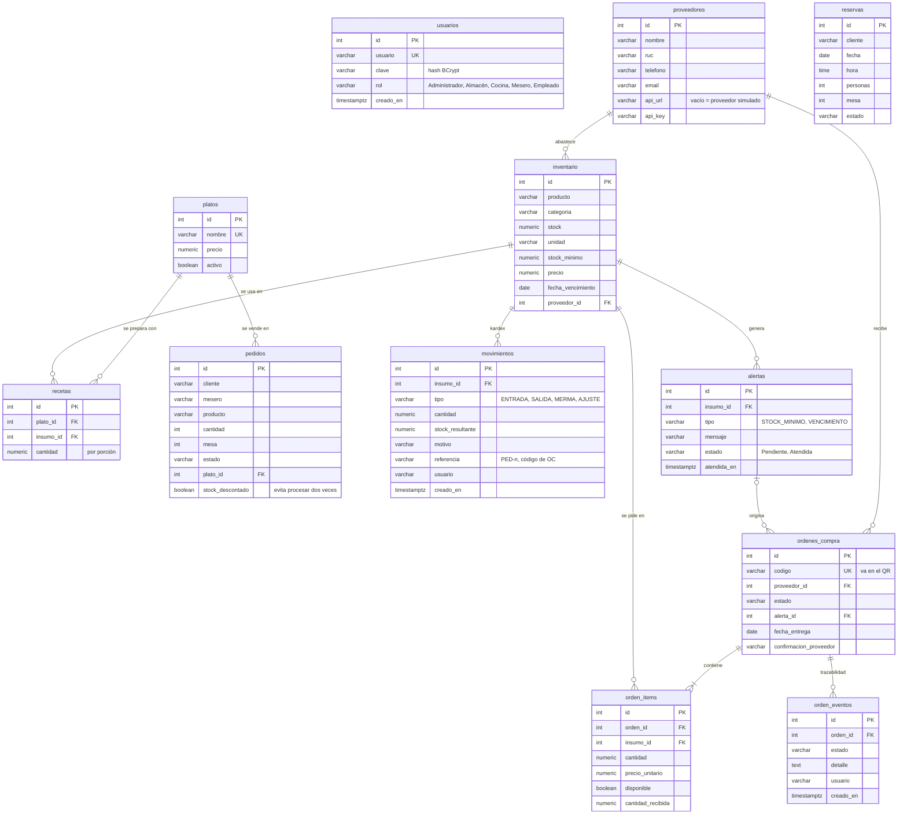

# Modelo de base de datos — CalSoft / La Crianza Arequipeña

Modelo que soporta las historias de usuario HU-01 a HU-09. Reemplaza a la
Figura 3 del documento (que solo tenía `mesas`, `reservas`, `pedidos`,
`usuarios` e `inventario`).

El script completo está en [`src/main/resources/schema.sql`](../src/main/resources/schema.sql).

> GitHub dibuja el diagrama automáticamente. Para tu documento puedes hacer una
> captura, o pegar el bloque en https://mermaid.live y exportarlo como imagen.

## Tablas nuevas y su historia de usuario

| Tabla | Para qué | HU |
|-------|----------|----|
| `proveedores` | Datos del proveedor y conexión a su API | HU-06, HU-07 |
| `platos`, `recetas` | Carta y cantidad de cada insumo por porción | HU-03 |
| `movimientos` | Kardex: cada cambio de stock con motivo y referencia; también es el histórico que usa la IA | HU-02, HU-03, HU-05 |
| `alertas` | Alertas automáticas de stock mínimo y vencimiento | HU-04 |
| `ordenes_compra`, `orden_items` | Orden con proveedor, insumos, cantidades, total y respuesta del proveedor | HU-06, HU-07, HU-08 |
| `orden_eventos` | Línea de tiempo: creada, aprobada, enviada, confirmada, recibida, errores de API | HU-09 |

Columnas nuevas: `inventario.fecha_vencimiento`, `inventario.proveedor_id`,
`pedidos.plato_id`, `pedidos.stock_descontado`; además el stock pasó a `NUMERIC`
para admitir cantidades como 0.25 kg.

> Nota: en tu figura había una tabla `mesas`. En el sistema la mesa se guarda
> como número dentro de `pedidos` y `reservas`. Si la quieres como tabla aparte,
> hay que agregarla; el resto del documento no depende de ella.
